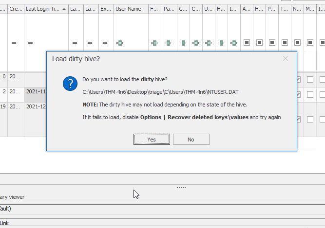
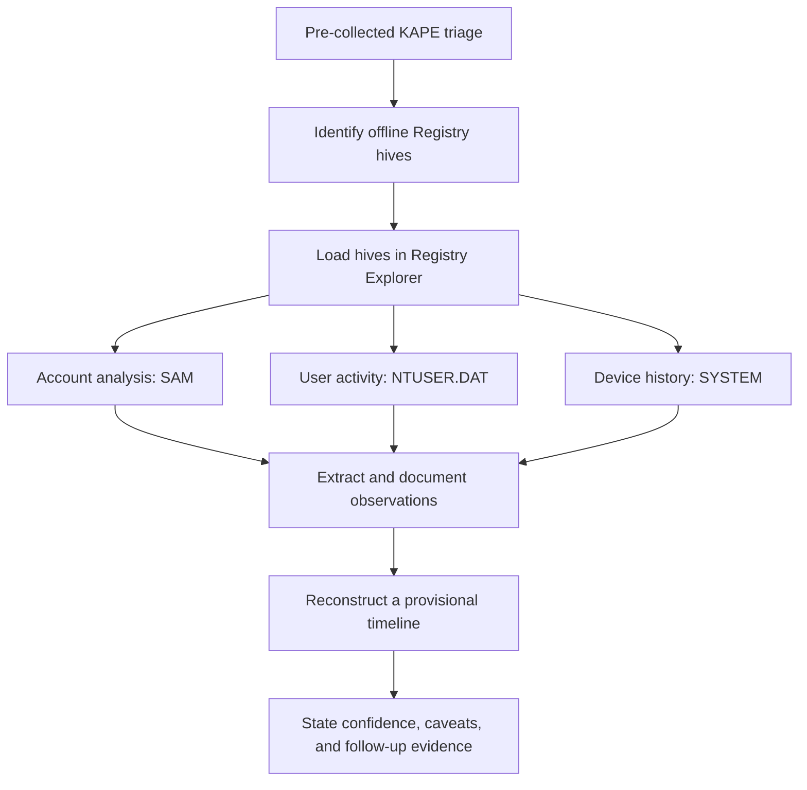
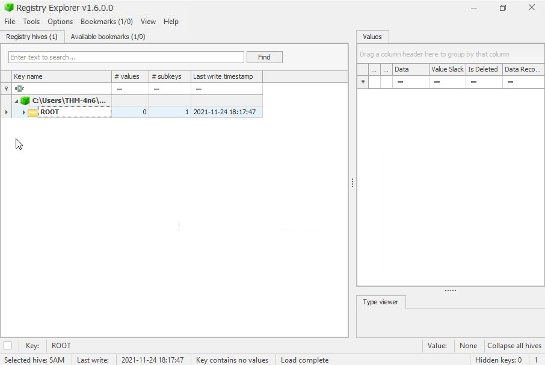
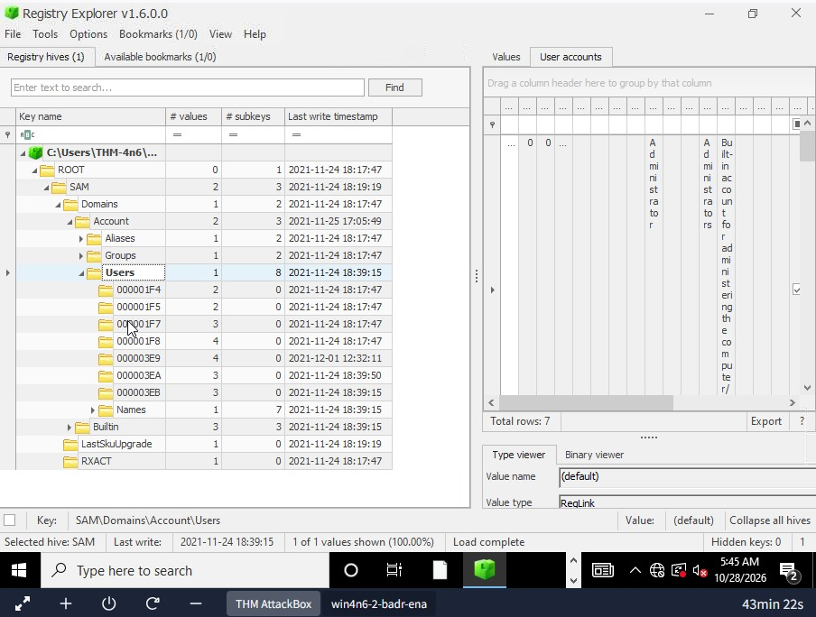
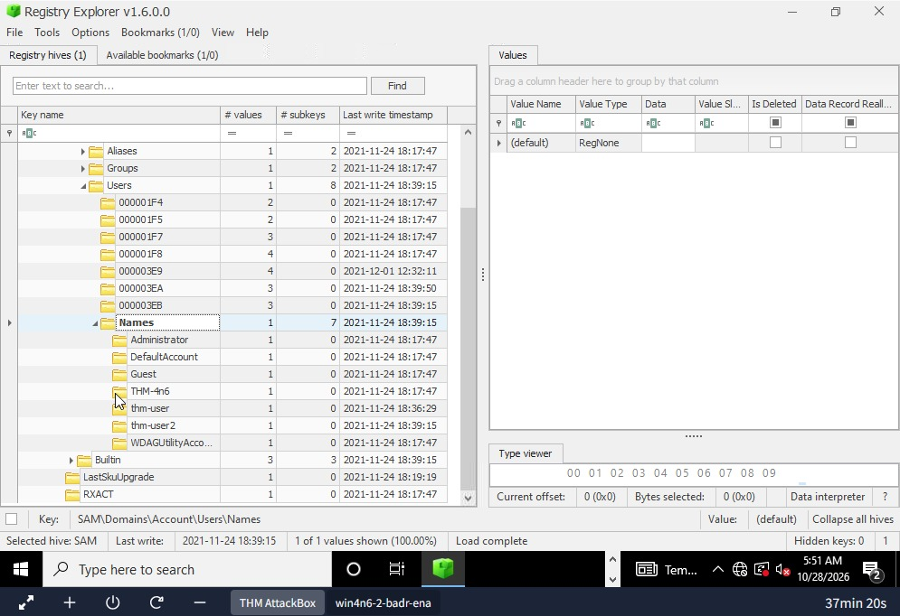
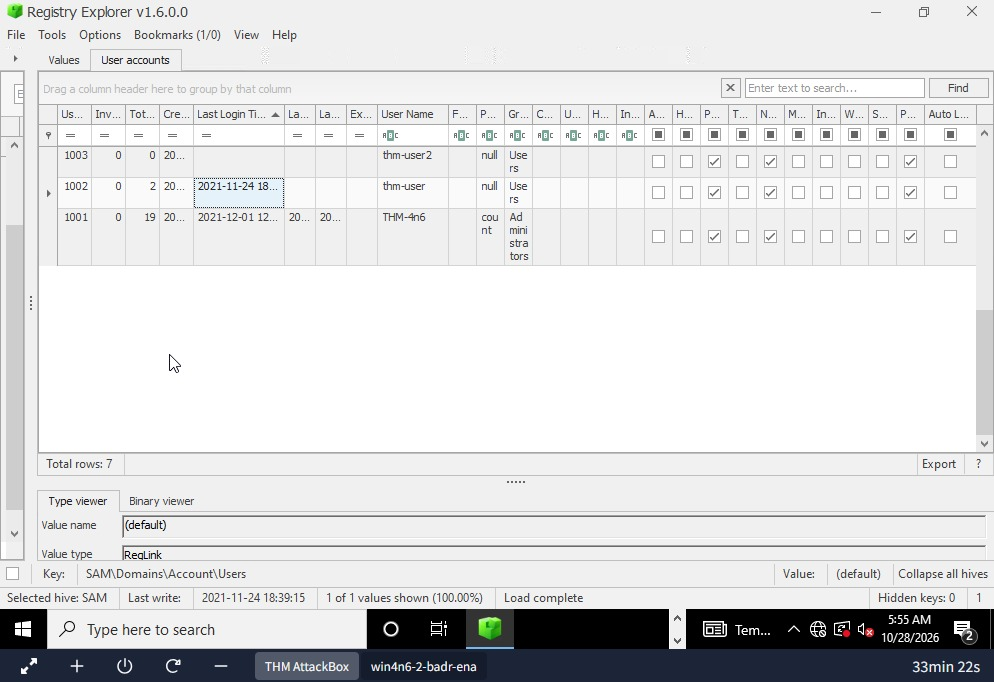
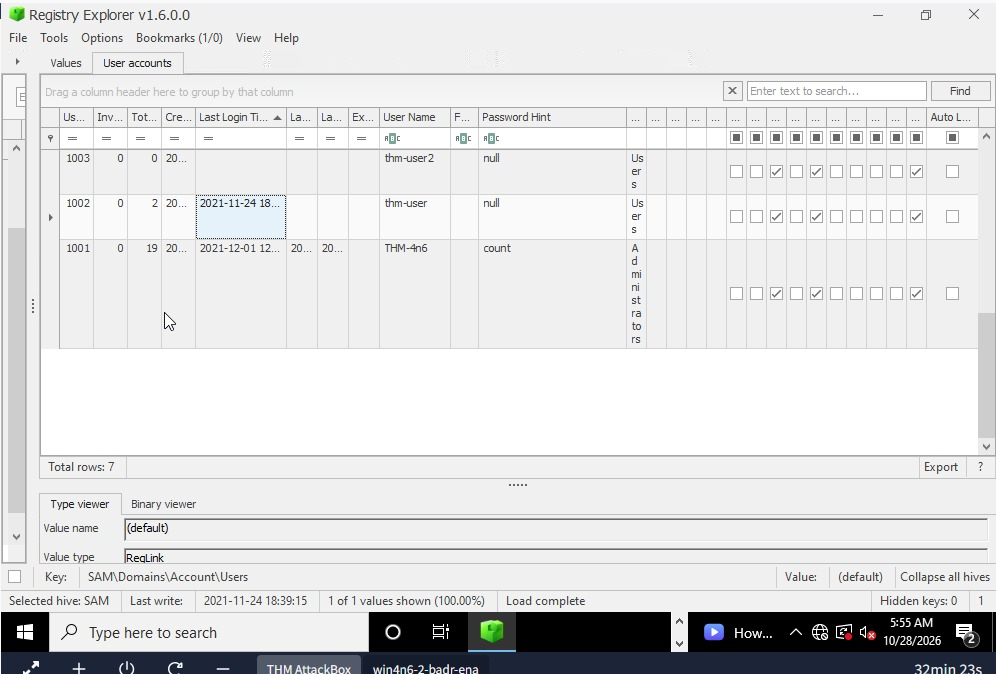
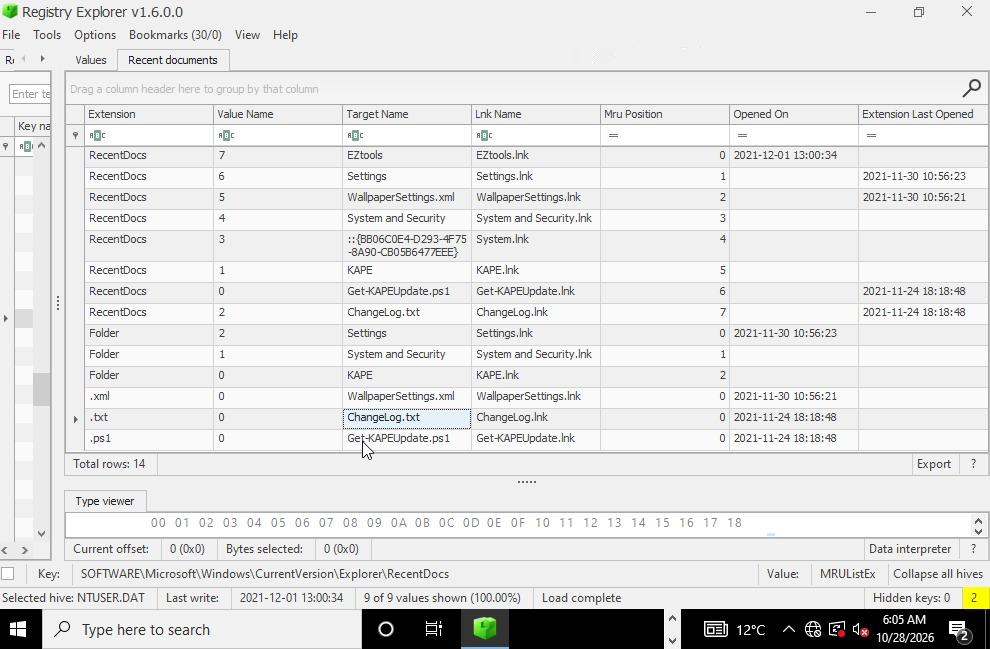
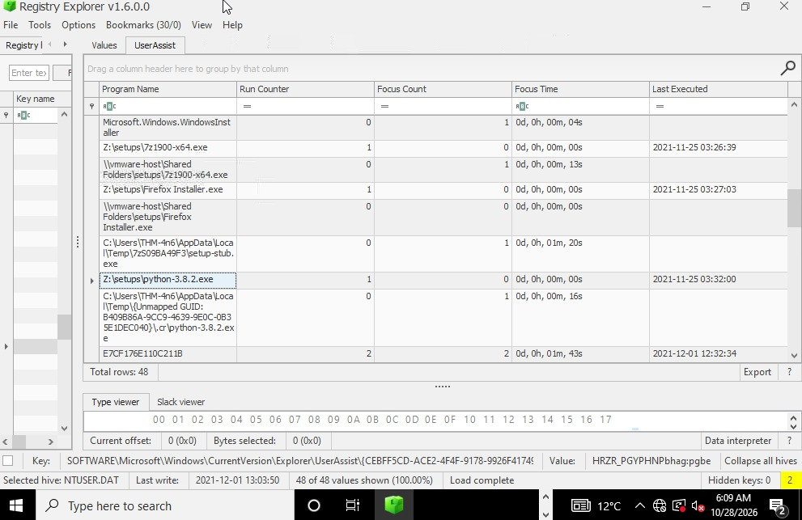
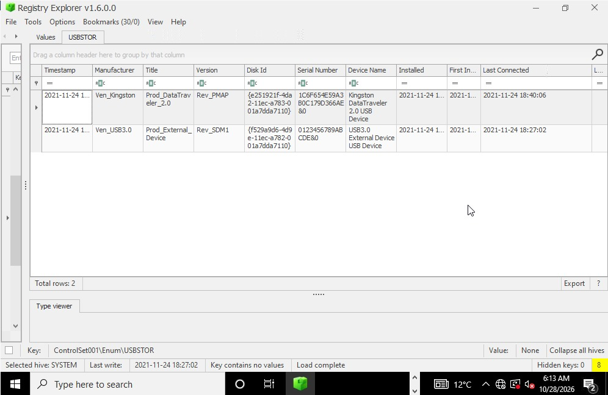

# Windows Forensics 1 — Registry Artifact Investigation

**A hands-on digital forensics case study | TryHackMe**

> **Training environment:** [TryHackMe — Windows Forensics 1](https://tryhackme.com/room/windowsforensics1)  
> **Focus:** Windows Registry forensics, offline hive analysis, account attribution, recent-document activity, execution artifacts, and USB history  
> **Primary tool:** Eric Zimmerman's **Registry Explorer v1.6.0.0**  
> **Evidence:** A pre-collected Windows triage dataset supplied by the lab  
> **Documentation date:** 28 October 2026  
> **Spoiler notice:** This case study includes the lab's final investigation findings.

---

## Executive summary

A research workstation at the fictional **Organization X** was suspected of unauthorized access. Investigators had observed multiple local accounts on a desktop that was normally intended for one user. They also wanted to understand recent file activity, execution of a Python installer, and the presence of external storage devices.

Rather than interact with the original workstation, I examined **offline Registry hives** from a KAPE-collected triage set using Registry Explorer. I investigated three complementary evidence sources:

- **SAM:** the local account database—account identities, relative identifiers (RIDs), logon metadata, and password hints.
- **NTUSER.DAT:** user-associated activity—recently used documents and programs launched via the Windows graphical shell.
- **SYSTEM:** machine-level configuration and USB device-enumeration records.

This investigation established **three non-built-in local accounts**, identified a local account with **zero recorded logons**, recovered a password hint, located a recently accessed document entry, recovered a Python installer execution path, and identified USB connection timestamps.

**The main lesson:** Registry artifacts are valuable traces of activity, but they are **not self-interpreting evidence of intent**. A defensible conclusion separates what an artifact records from what still requires corroboration.

### Investigation at a glance

| Area | Artifact | Result from the lab evidence | Interpretation |
|---|---|---|---|
| Account inventory | `SAM\Domains\Account\Users` | 3 non-built-in local accounts | Unexpected accounts can be identified, but the reason for their creation is unknown. |
| Logon history | SAM user metadata | `thm-user2`: 0 recorded logons | The SAM does not record a successful logon for this account. |
| Account configuration | SAM user metadata | `THM-4n6` password hint: `count` | A configured account hint, **not** the password itself. |
| Document activity | `NTUSER.DAT\...\Explorer\RecentDocs` | `ChangeLog.txt` — `2021-11-24 18:18:48` | Registry Explorer's relevant **Extension Last Opened** timestamp. |
| Program activity | `NTUSER.DAT\...\Explorer\UserAssist` | `Z:\setups\python-3.8.2.exe` | GUI-associated execution record; not proof of successful installation. |
| External storage | `SYSTEM\ControlSet001\Enum\USBSTOR` | `2021-11-24 18:40:06` | Last connected time for the Kingston device row inspected in the lab. |

> **Scope and honesty statement:** This is a **training-lab reconstruction**, not a real client engagement. I did not independently acquire or image the original workstation, compute hashes of the original Registry hives, or validate a forensic chain of custody. The screenshots record my analysis of the lab-supplied data. Timestamps are reproduced **as displayed in Registry Explorer**; the source machine's time-zone configuration was not independently established in this exercise.

---

## Contents

1. [Investigation context and questions](#1-investigation-context-and-questions)
2. [Core forensic concepts](#2-core-forensic-concepts)
3. [Evidence sources and tools](#3-evidence-sources-and-tools)
4. [Examination methodology](#4-examination-methodology)
5. [Finding 1 — Local accounts and RIDs](#5-finding-1--local-accounts-and-rids)
6. [Finding 2 — Logon history and password hint](#6-finding-2--logon-history-and-password-hint)
7. [Finding 3 — RecentDocs and ChangeLog.txt](#7-finding-3--recentdocs-and-changelogtxt)
8. [Finding 4 — UserAssist and Python execution](#8-finding-4--userassist-and-python-execution)
9. [Finding 5 — USB storage history](#9-finding-5--usb-storage-history)
10. [Reconstructed activity timeline](#10-reconstructed-activity-timeline)
11. [Interpretation, alternative hypotheses, and limitations](#11-interpretation-alternative-hypotheses-and-limitations)
12. [Artifact field guide](#12-artifact-field-guide)
13. [Analyst workflow and validation checklist](#13-analyst-workflow-and-validation-checklist)
14. [What this lab taught me](#14-what-this-lab-taught-me)
15. [Next investigations and interview preparation](#15-next-investigations-and-interview-preparation)
16. [References and attribution](#16-references-and-attribution)

---

## 1. Investigation context and questions

### Scenario

Organization X's research desktop is suspected of access by an unauthorized person. Its normal operating practice is one user account per workstation, but several accounts were observed. Investigators also suspect activity involving a mapped or network-accessible drive and removable storage.

### Investigative questions

1. How many user-created local accounts are represented in the Registry evidence?
2. Which local account has no recorded logons?
3. What password hint is associated with the primary lab account?
4. What recent-document timestamp is associated with `ChangeLog.txt`?
5. From what recorded path was the Python 3.8.2 installer run?
6. When was the relevant USB storage device last connected?

### Scope of examination

**In scope:** offline Registry-hive analysis using the files already provided in the lab; interpretation of parsed Registry metadata; comparison of multiple entries within an artifact.

**Not performed:** forensic imaging of a physical workstation; memory analysis; malware reverse engineering; full event-log correlation; file-system reconstruction; recovery of USB contents; attribution to a named individual; or formal evidence seizure.

**Analytical standard:** distinguish **observation**, **reasonable inference**, and **unproven hypothesis**.

---

## 2. Core forensic concepts

### What is digital forensics?

Digital forensics is a disciplined process of **identifying, preserving, collecting, examining, analyzing, and reporting digital evidence**. The purpose is to reconstruct events and explain the extent to which the available evidence supports or contradicts a hypothesis.

In a corporate incident response case, this might mean determining which accounts existed, what software ran, whether external storage was recognized, and what the system's recorded timestamps indicate. It does **not** mean treating any suspicious-looking entry as proof of wrongdoing.

### What is a forensic artifact?

A **forensic artifact** is data produced or maintained by an operating system or application that may be informative during an investigation. Examples include:

| Artifact | Typical investigative use | Caution |
|---|---|---|
| Windows Registry | Accounts, configuration, devices, per-user traces | Values depend on OS version, subsystem, and retention. |
| Windows Event Logs | Logons, account changes, system and security events | Logging/auditing must have been enabled and retained. |
| Prefetch | Evidence associated with program execution | Availability and semantics depend on configuration and version. |
| Amcache | Application and file metadata | An entry alone does not always establish execution. |
| LNK shortcuts / Jump Lists | References to files, applications, or locations | Not proof the referenced content was read. |
| NTFS `$MFT` / `$UsnJrnl` | File-system metadata and changes | Requires interpretation and clock consistency. |
| Device setup logs | Device installation and driver activity | Installation is not identical to each connection. |

### Windows Registry: keys, values, and hives

The Windows Registry is a hierarchical database containing system, software, hardware, and user settings. The basic distinctions are:

- **Key:** a node resembling a folder.
- **Subkey:** a key nested under another key.
- **Value:** a named entry within a key.
- **Value data:** the underlying string, integer, binary data, or other content.
- **Hive:** an on-disk Registry data store containing a group of keys and values.
- **Key LastWrite:** the time a Registry key was last modified—not necessarily the time the file, application, or device described by it was last used.

The five common logical Registry root keys are `HKEY_LOCAL_MACHINE`, `HKEY_CURRENT_USER`, `HKEY_USERS`, `HKEY_CLASSES_ROOT`, and `HKEY_CURRENT_CONFIG`. These are **logical views**, not five simple one-to-one files. For example, `HKEY_CURRENT_USER` typically corresponds to the active user's `NTUSER.DAT` hive; `HKEY_CLASSES_ROOT` is a merged view of relevant class-registration settings.

### Why offline analysis matters

A live machine is changing continuously: programs run, logs rotate, accounts sign in, and Registry values update. Offline analysis of a preserved acquisition helps reduce alteration of the source evidence and allows repeatable examination.

A sound forensic workflow also distinguishes a **working copy** from the original acquired bytes. Any repaired or replayed Registry hive should be an output of analysis, not an overwrite of the source.

---

## 3. Evidence sources and tools

### Evidence layout

The lab VM included two folders on the desktop:

```text
Desktop/
├── triage/                      # Previously collected evidence (KAPE output)
│   └── C/
│       ├── Windows/
│       │   └── System32/
│       │       └── config/
│       │           ├── SAM
│       │           ├── SYSTEM
│       │           ├── SOFTWARE
│       │           └── [associated transaction logs, where present]
│       └── Users/
│           └── THM-4n6/
│               └── NTUSER.DAT
└── EZtools/                     # Registry Explorer and other analysis tools
```

*The diagram highlights relevant files rather than showing the complete triage collection.*

### Hives used in this case

| Hive | On-disk location on the source Windows system | Why it mattered |
|---|---|---|
| `SAM` | `C:\Windows\System32\config\SAM` | Local users, account RIDs, logon counts, and password hints. |
| `NTUSER.DAT` | `C:\Users\<user>\NTUSER.DAT` | User-associated RecentDocs and UserAssist artifacts. |
| `SYSTEM` | `C:\Windows\System32\config\SYSTEM` | USB device-enumeration data and machine configuration. |
| `SOFTWARE` | `C:\Windows\System32\config\SOFTWARE` | Useful for further correlation of OS information and portable-device names; **not independently examined in the screenshots presented here**. |

### Tooling and responsibilities

| Tool | Role in the workflow | What I actually used |
|---|---|---|
| **KAPE** | Targeted artifact acquisition and processing. | The lab supplied a collection that had already been created using KAPE. |
| **Registry Explorer v1.6.0.0** | Open offline hives; browse keys; parse and display forensic artifacts. | **Primary analysis tool**, as shown in screenshots. |
| **Eric Zimmerman's EZ Tools** | Broader Windows artifact analysis utilities. | Available in the lab; no claim of separately executing every utility. |
| **RegRipper / Autopsy** | Alternative ways to parse or inspect forensic evidence. | Discussed as alternatives; not used to produce the documented results. |

### Handling a dirty Registry hive

Some acquired Registry hives may be marked **dirty**. This can happen when the main hive and associated transaction state are not fully synchronized. Registry Explorer may offer to load the hive and/or recover changes from `.LOG1` and `.LOG2` files.

My handling approach for the lab:

1. Select the offline hive in Registry Explorer.
2. Acknowledge the dirty-hive warning and follow any transaction-log recovery prompts.
3. Use matching logs from the same acquisition, when available.
4. Save a recovered/cleaned hive as a **separate analysis copy**.
5. Preserve the original collected hive and logs unchanged.



*Figure 1 — Registry Explorer's dirty-hive prompt while loading `NTUSER.DAT`. Loading a dirty hive is not the same as documenting successful transaction-log replay.*

> **Chain-of-custody note:** The lab provided the hives; my screenshots do not establish their original acquisition hashes, recovery log, source disk image, or chain of custody. In real casework these would be recorded before analysis.

---

## 4. Examination methodology

I used a **question-driven, artifact-first workflow**: define what must be established, choose the Registry data likely to contain it, inspect the parsed results, then document the limitations of each observation.



**My working sequence:**

1. Start Registry Explorer and confirm the number of loaded hives.
2. Load `SAM` and inspect account RIDs, names, login counts, and password hints.
3. Load the relevant user's `NTUSER.DAT` and inspect `RecentDocs`.
4. Inspect `UserAssist\{GUID}\Count` for executable paths and recorded last-execution times.
5. Load `SYSTEM`, locate the relevant control set, and inspect `Enum\USBSTOR`.
6. Record only the findings supported by the actual rows and timestamps shown in the parser.
7. Organize observations into a timeline without inventing causal links.

### Important interface distinction

The **left panel** of Registry Explorer shows the hive's key hierarchy and key LastWrite times. The **right panel** can show parser-specific tables such as *User accounts*, *Recent documents*, *UserAssist*, or *USBSTOR*.

A key LastWrite time is **not automatically** a login time, a file-open time, a process-execution time, or a USB arrival time. I used the appropriate parsed fields rather than assuming those events were interchangeable.

---

## 5. Finding 1 — Local accounts and RIDs

**Question:** How many user-created accounts are present on the workstation?

**Hive:** `SAM`  
**Key:** `SAM\Domains\Account\Users`

### Examination steps

1. Open Registry Explorer and load the offline `SAM` hive from the triage folder.
2. Expand `ROOT → SAM → Domains → Account → Users`.
3. Inspect the hexadecimal RID subkeys and the `Names` subkey.
4. Distinguish well-known built-in accounts from ordinary local accounts.
5. Confirm the names using Registry Explorer's parsed **User accounts** tab.



*Figure 2 — The offline SAM hive has loaded; the key hierarchy can now be expanded.*



*Figure 3 — The `Users` key contains account RID subkeys. `Total rows: 7` includes built-in accounts and must not be reported as the number of user-created accounts.*



*Figure 4 — The `Names` subkey makes the account names visible.*

### Observed accounts

| RID (hex) | RID (decimal) | Username | Classification |
|---|---:|---|---|
| `000001F4` | 500 | `Administrator` | Built-in Administrator |
| `000001F5` | 501 | `Guest` | Built-in Guest |
| `000001F7` | 503 | `DefaultAccount` | Built-in account |
| `000001F8` | 504 | `WDAGUtilityAccount` | Built-in account |
| `000003E9` | 1001 | `THM-4n6` | Ordinary local account |
| `000003EA` | 1002 | `thm-user` | Ordinary local account |
| `000003EB` | 1003 | `thm-user2` | Ordinary local account |

**Finding:** **Three non-built-in local accounts** were represented: `THM-4n6`, `thm-user`, and `thm-user2`.

### What is an RID?

A **Relative Identifier (RID)** is the account-specific component of a Windows security identifier (SID). The full SID identifies a security principal; accounts within the same local domain have different RIDs. For example, hexadecimal `000003E9` is decimal `1001`.

Built-in accounts use known RIDs such as **500** for Administrator and **501** for Guest. Ordinary local accounts often receive RIDs of **1000 or greater**. That range is a helpful triage heuristic, **not a substitute for reviewing names, account types, and group membership**.

### Professional interpretation

The presence of multiple local accounts is **consistent with** the lab's concern about unexpected users. It does **not** establish that the accounts were created by an attacker, that they were used by different people, or that any particular user was unauthorized. A production investigation would compare this inventory with the approved endpoint configuration and historical account-management events.

---

## 6. Finding 2 — Logon history and password hint

**Questions:** Which account has never logged in according to SAM, and what is the password hint for `THM-4n6`?

**Hive/key:** `SAM\Domains\Account\Users`  
**View:** Registry Explorer → **User accounts**

### Examination steps

1. Select `SAM\Domains\Account\Users`.
2. Open the **User accounts** tab in the right-hand pane.
3. Widen the table columns to reveal **Total Logins**, **Last Login Time**, **User Name**, and **Password Hint**.
4. Compare the three ordinary local accounts rather than counting built-ins.



*Figure 5 — Registry Explorer's parsed user-account records show RIDs, usernames, and logon counts.*

### Logon metadata observed

| Account | RID | Recorded total logins | Last login shown in screenshot |
|---|---:|---:|---|
| `THM-4n6` | 1001 | **19** | A populated timestamp |
| `thm-user` | 1002 | **2** | A populated timestamp |
| `thm-user2` | 1003 | **0** | No timestamp shown |

**Finding:** `thm-user2` had **zero recorded logons** in the examined SAM evidence.

This is properly phrased as **“no recorded logon in the available SAM metadata”**. It is stronger than a guess about who used the workstation, but narrower than a universal claim that the account could never have been used.

### Password-hint evidence



*Figure 6 — The `THM-4n6` row shows `count` under the `Password Hint` column.*

**Finding:** The configured password hint for `THM-4n6` was **`count`**.

A password hint is **not a plaintext password** and does not show that the investigator recovered the password. It may indicate how a user intended to remember a secret, but should not be confused with credential extraction.

### Corroboration in a production investigation

- Windows Security Event **4624**: successful logon, where auditing and retention allow.
- Event **4625**: failed logon attempts, if logged.
- Event **4720**: account creation, if account-management auditing was enabled.
- Relevant local group membership and account changes.
- Endpoint management / identity records to establish whether accounts were authorized.

Account timestamps can reflect logon-recording behavior, not a complete record of every authentication event. Absence of a specific Windows event is also inconclusive if auditing was disabled, the log rolled over, or the evidence was not collected.

---

## 7. Finding 3 — RecentDocs and ChangeLog.txt

**Question:** When was `ChangeLog.txt` accessed, according to the exercise's Registry evidence?

**Hive:** `NTUSER.DAT`  
**Key:** `Software\Microsoft\Windows\CurrentVersion\Explorer\RecentDocs`  
**Subkey of interest:** `.txt`

### Examination steps

1. Load the user's offline `NTUSER.DAT` hive.
2. Expand `ROOT → Software → Microsoft → Windows → CurrentVersion → Explorer → RecentDocs`.
3. Select the parent `RecentDocs` key and/or `.txt` subkey.
4. Switch to Registry Explorer's **Recent documents** parser tab.
5. Locate `ChangeLog.txt` and expand the timestamp columns.



*Figure 7 — `ChangeLog.txt` appears in RecentDocs. The relevant `.txt` row displays `2021-11-24 18:18:48` under **Extension Last Opened**.*

### Evidence observed

| Field | Value |
|---|---|
| User hive | `NTUSER.DAT` for `THM-4n6` |
| Registry artifact | `Explorer\RecentDocs` |
| Document | `ChangeLog.txt` |
| Extension | `.txt` |
| MRU position within `.txt` | `0` |
| Relevant parser field | `Extension Last Opened` |
| Displayed time | **`2021-11-24 18:18:48`** |

**Finding:** `ChangeLog.txt` is associated with a RecentDocs entry and the displayed `.txt` extension's **Last Opened** timestamp of **24 November 2021 at 18:18:48**.

### Why MRU matters

**MRU** stands for **Most Recently Used**. Many Windows components remember the ordering of recently interacted-with items. An MRU position can provide useful *relative ordering*, even when a distinct, item-level timestamp is unavailable.

### Critical timestamp distinction

In the screenshot, the timestamp for the `.txt` entry is displayed in **Extension Last Opened**, while the row's **Opened On** cell is blank. Accordingly, the time should **not** be represented as a fully independent, per-file NTFS Last Access timestamp. The room uses this value to answer its question; a professional analyst would describe exactly which field provided the time and corroborate with other sources.

### Alternative evidence

LNK shortcuts, Jump Lists, `ComDlg32` Open/Save MRUs, application history, file-system timestamps, and Windows Event Logs can help establish whether and how a file was accessed. None is universally available; each has its own recording behavior.

---

## 8. Finding 4 — UserAssist and Python execution

**Question:** From what complete path was the Python 3.8.2 installer run?

**Hive:** `NTUSER.DAT`  
**Key:** `Software\Microsoft\Windows\CurrentVersion\Explorer\UserAssist\{GUID}\Count`

### Examination steps

1. Stay in the `NTUSER.DAT` hive.
2. Navigate to `Explorer\UserAssist`.
3. Expand the relevant GUID subkey and select `Count`.
4. Open the parsed **UserAssist** tab.
5. Find `python-3.8.2.exe` under **Program Name** and inspect the run counter and execution timestamp.



*Figure 8 — Registry Explorer decodes UserAssist records and displays the path, run counter, and last-executed time for the installer.*

### Evidence observed

| Field | Value |
|---|---|
| Recorded path | **`Z:\setups\python-3.8.2.exe`** |
| Run counter shown | `1` |
| Last executed shown | **`2021-11-25 03:32:00`** |
| Source | `NTUSER.DAT` → `UserAssist` → `Count` |

**Finding:** UserAssist contains a GUI-associated execution entry for the installer at **`Z:\setups\python-3.8.2.exe`**.

### How UserAssist works

Windows tracks certain applications and shortcuts launched via the **Explorer shell**. The UserAssist Registry data is per user; its value names commonly use **ROT13**, a letter-substitution encoding that rotates alphabetic characters by 13 positions. It is not encryption or a security control.

For example:

```text
Decoded: python-3.8.2.exe
ROT13:   clguba-3.8.2.rkr
```

Registry Explorer presents a readable interpretation of those encoded entries. A nonzero run counter together with a recorded execution timestamp is useful evidence of shell-associated program launch activity.

**Important limits:**

- UserAssist does not capture all execution methods; a program launched only from a script, command interpreter, or service may leave no UserAssist entry.
- The row does not prove that the **Python installation completed successfully**.
- The path does not prove that `Z:` was a network share; it could have been mapped or otherwise mounted. The lab's network-drive suspicion should be tested, not assumed.
- The displayed timestamp requires time-zone normalization before correlation with differently formatted artifacts.

### What I would investigate next

To characterize `Z:`, I would examine available network-drive mappings (including relevant user `Network` keys), MountPoints2, shortcut references, and any volume or share records. I would check Prefetch and other execution artifacts for corroboration and examine the installer file's signature/hash if the file itself were available.

This is a good example of **a potentially interesting lead without an established malicious conclusion**.

---

## 9. Finding 5 — USB storage history

**Question:** When was the relevant USB device last connected?

**Hive:** `SYSTEM`  
**Key displayed in the screenshot:** `ControlSet001\Enum\USBSTOR`

### Examination steps

1. Load the offline `SYSTEM` hive.
2. Examine `SYSTEM\Select\Current` to determine the current control-set number where possible.
3. Navigate to the corresponding `ControlSet00x\Enum\USBSTOR` location.
4. Open Registry Explorer's **USBSTOR** parser tab.
5. Compare device names, manufacturers, identifiers, and **Last Connected** fields.
6. For confirmation of a user-facing friendly/volume name, compare against `SOFTWARE\Microsoft\Windows Portable Devices\Devices` when that hive is available.



*Figure 9 — Two USB storage-device entries are visible, each with a separate Last Connected timestamp. The selected view is `ControlSet001\Enum\USBSTOR`.*

### Evidence observed

| Device row | Device identification shown | Last Connected |
|---|---|---|
| Kingston DataTraveler 2.0 USB Device | Kingston / DataTraveler 2.0 | **`2021-11-24 18:40:06`** |
| USB3.0 External Device USB Device | USB3.0 / External Device | `2021-11-24 18:27:02` |

**Finding:** The Kingston device row shows a last-connection time of **24 November 2021 at 18:40:06**. This corresponds to the exercise's accepted answer for the USB device in question.

The first row's instance serial identifier, as displayed across wrapped text in the screenshot, is consistent with:

```text
1C6F654E59A3B0C179D366AE&0
```

The screenshot **does not independently display the lab prompt's exact friendly name `USB`** as a verified volume-label mapping. In a real report, I would verify that naming relationship in `SOFTWARE\Microsoft\Windows Portable Devices\Devices` and/or other device/volume artifacts rather than assume that a model name and a user-facing label are interchangeable.

### USBSTOR device-time properties

At a device-instance's `Properties` subkeys, Windows maintains timestamp properties. One commonly examined property-set GUID is:

```text
{83da6326-97a6-4088-9453-a1923f573b29}
```

| Property ID | Windows device-property meaning | Investigative relevance |
|---|---|---|
| `0064` | Device installation date | **Not necessarily first connection**; it is commonly the last install/update time. |
| `0065` | Device first-install date | When the device instance was first installed. |
| `0066` | Last arrival | Last recorded arrival/connection. |
| `0067` | Last removal | Last recorded removal/disconnection. |

> **Accuracy note:** Some introductory forensic cheatsheets call `0064` “first connection.” The underlying Windows device-property terminology distinguishes **install date (`0064`)** from **first install date (`0065`)**. For this question the relevant property is **last arrival (`0066`)**, and Registry Explorer directly displays the parsed **Last Connected** field.

### What USB evidence does—and does not—prove

USBSTOR can support the conclusion that Windows recognized an external mass-storage device. It can identify device instances and recorded connection times. It does **not**, by itself, show that a particular file was copied to the USB, who physically connected it, or whether a security breach occurred.

Useful supporting sources include:

- `SYSTEM\MountedDevices` and relevant volume GUIDs for drive/volume associations.
- `SOFTWARE\Microsoft\Windows Portable Devices\Devices` for device/volume naming.
- User `MountPoints2` data for user-associated volume interactions.
- `setupapi.dev.log` for installation events.
- LNK files and Jump Lists for referenced removable-drive paths.
- `$MFT`, `$UsnJrnl`, file metadata, and any available file-transfer telemetry for a stronger exfiltration hypothesis.

---

## 10. Reconstructed activity timeline

This timeline combines **only observations actually visible in the supplied screenshots**. The timestamps are listed as shown by Registry Explorer, without asserting a verified common UTC offset.

| Displayed timestamp | Recorded observation | Source | What it does **not** establish |
|---|---|---|---|
| **2021-11-24 18:18:48** | `ChangeLog.txt` under `.txt` RecentDocs with an Extension Last Opened value | `NTUSER.DAT` / RecentDocs | A definite per-file NTFS access event or proof of reading content. |
| **2021-11-24 18:27:02** | USB3.0 External Device: Last Connected | `SYSTEM` / USBSTOR | File transfer or human identity. |
| **2021-11-24 18:40:06** | Kingston DataTraveler 2.0: Last Connected | `SYSTEM` / USBSTOR | Copying data to the device. |
| **2021-11-25 03:32:00** | Python 3.8.2 installer path recorded with run counter 1 | `NTUSER.DAT` / UserAssist | Successful Python installation or malicious execution. |

### What the sequence suggests

The artifacts show document-history activity, then two USB records with different last-connection timestamps, followed later by a Python-installer execution entry. The ordering helps prioritize questions, but **does not establish a causal sequence**: it does not show that the document was copied to USB, nor that the installer was obtained from the USB or a network drive.

This separation between **temporal proximity** and **causal proof** is central to credible forensic reporting.

---

## 11. Interpretation, alternative hypotheses, and limitations

### Working hypotheses

| Hypothesis | Evidence that may support further investigation | Current assessment |
|---|---|---|
| An unauthorized local account was created | Three non-built-in local accounts and an organization expecting one user | **Unresolved.** Need account-creation logs, timestamps, and asset-owner authorization. |
| A document was interacted with before external devices were connected | RecentDocs record and USB last-connection fields on the same day | **Possible temporal association only.** No file-transfer proof. |
| The Python installer came from a network-accessible location | A `Z:` executable path in UserAssist | **Unresolved.** Drive mapping and executable source not independently established. |
| A USB device was connected | USBSTOR device-instance entries with Last Connected times | **Supported within the recorded artifact's limitations.** |
| Python 3.8.2 was successfully installed | UserAssist entry for the installer executable | **Not established.** Execution and installation are distinct. |

### Confidence and evidence boundaries

- **High confidence in transcription:** the screenshot tables directly display account names, counts, the password hint, installer path, and relevant timestamps.
- **Moderate contextual confidence:** the parser's fields describe the corresponding Windows artifacts, but there was no second-tool validation or cross-artifact verification in this exercise.
- **Not supported:** attribution to a person, malicious intent, exfiltration, completed software installation, and the exact friendly-name mapping for the Kingston device.

### Practical limitations

1. **Limited acquisition context:** no original disk image, collection metadata, or original-hive cryptographic hashes were provided for independent review.
2. **Time-zone uncertainty:** time-zone settings of the source system were not verified; apparent chronological ordering must be normalized before cross-source reporting.
3. **Parser dependence:** interpretation is based on Registry Explorer's displayed fields. A second parser could help validate important findings.
4. **Incomplete correlation:** Event Logs, file-system metadata, browser data, Prefetch, and device installation logs were not included in this documented analysis.
5. **Historical artifact semantics:** values and retention behavior vary by Windows version, feature configuration, and update history.
6. **Synthetic training context:** results are appropriate for a TryHackMe learning exercise and should not be represented as findings from a real breach investigation.

---

## 12. Artifact field guide

A compact reference for future Windows DFIR investigations. **“Where to look” does not mean every artifact exists or has the same semantics on every Windows version.**

| Investigative objective | Typical hive/artifact | Common path |
|---|---|---|
| Local accounts and logon metadata | SAM | `SAM\Domains\Account\Users` |
| Windows OS/version information | SOFTWARE | `Microsoft\Windows NT\CurrentVersion` |
| Current control-set selection | SYSTEM | `Select\Current` |
| Computer name | SYSTEM | `ControlSet00x\Control\ComputerName\ComputerName` |
| Time-zone configuration | SYSTEM | `ControlSet00x\Control\TimeZoneInformation` |
| Autostart entries | SOFTWARE / NTUSER.DAT | `Microsoft\Windows\CurrentVersion\Run` and `RunOnce` |
| Recently accessed documents | NTUSER.DAT | `Software\Microsoft\Windows\CurrentVersion\Explorer\RecentDocs` |
| GUI-launched program activity | NTUSER.DAT | `Software\Microsoft\Windows\CurrentVersion\Explorer\UserAssist\{GUID}\Count` |
| Open/Save dialog history | NTUSER.DAT | `Software\Microsoft\Windows\CurrentVersion\Explorer\ComDlg32` |
| Folder-view traces | NTUSER.DAT / USRCLASS.DAT | `...\Shell\BagMRU` and `...\Shell\Bags` |
| USB storage-device history | SYSTEM | `ControlSet00x\Enum\USBSTOR` |
| USB device enumeration | SYSTEM | `ControlSet00x\Enum\USB` |
| Drive / device naming | SOFTWARE | `Microsoft\Windows Portable Devices\Devices` |
| Volume-letter mappings | SYSTEM | `MountedDevices` |
| Network interface configuration | SYSTEM | `ControlSet00x\Services\Tcpip\Parameters\Interfaces` |
| BAM activity (where supported) | SYSTEM | `ControlSet00x\Services\bam\UserSettings\{SID}` |
| Compatibility cache | SYSTEM | `ControlSet00x\Control\Session Manager\AppCompatCache` |
| Application metadata | Amcache hive | `C:\Windows\AppCompat\Programs\Amcache.hve` |

**Control-set note:** Offline SYSTEM hives generally contain `ControlSet001`, `ControlSet002`, etc. The live `CurrentControlSet` is a runtime alias. Check `SYSTEM\Select\Current` to identify which numbered control set corresponds to the current one for that hive.

### Registry-root versus hive-file quick reference

| Logical Registry area | Common backing evidence |
|---|---|
| `HKEY_LOCAL_MACHINE\SAM` | `SAM` |
| `HKEY_LOCAL_MACHINE\SYSTEM` | `SYSTEM` |
| `HKEY_LOCAL_MACHINE\SOFTWARE` | `SOFTWARE` |
| `HKEY_LOCAL_MACHINE\SECURITY` | `SECURITY` |
| `HKEY_USERS\.DEFAULT` | `DEFAULT` |
| `HKEY_CURRENT_USER` | Logged-on user's `NTUSER.DAT` |
| `HKEY_CURRENT_USER\Software\Classes` | Commonly associated with `UsrClass.dat` |

---

## 13. Analyst workflow and validation checklist

### A repeatable approach for future cases

- [ ] Define authority, scope, objectives, and investigative questions.
- [ ] Record collection source, tool versions, system identifiers, and acquisition timestamps.
- [ ] Preserve the collected evidence; compute **SHA-256 hashes of original evidence files** when available.
- [ ] Work from copies and preserve original transaction logs.
- [ ] Document whether Registry transaction logs were replayed and where output was saved.
- [ ] Establish Windows version, computer name, control set, and source time zone.
- [ ] Select relevant artifacts based on the investigative question—not on whatever tool view looks interesting.
- [ ] Save exportable parser results and screenshots with a reproducible artifact path.
- [ ] Distinguish key LastWrite, device-install dates, device-arrival dates, program-execution times, and document-MRU metadata.
- [ ] Correlate important claims with at least one independent artifact when possible.
- [ ] Record limitations, alternative explanations, and an evidence-supported conclusion.

### Safe working commands (on copies, not originals)

If a future lab provides actual hive files and a working local evidence directory, PowerShell can compute a SHA-256 digest:

```powershell
Get-FileHash -Algorithm SHA256 -Path "C:\Analysis\Evidence\SAM"
Get-FileHash -Algorithm SHA256 -Path "C:\Analysis\Evidence\NTUSER.DAT"
Get-FileHash -Algorithm SHA256 -Path "C:\Analysis\Evidence\SYSTEM"
```

These commands are **examples for a future investigation**. Their output is **not** claimed as a result from this lab.

For verification, one could use a second Registry parser, compare parsed values with the original hive data, and preserve the raw key paths that support each conclusion. A screenshot is useful for a portfolio, but it is **not a substitute for preserved primary evidence**.

The separate [`SHA256SUMS.txt`](SHA256SUMS.txt) included in this repository hashes **only these published screenshot files**. It is a packaging-integrity aid, **not** a chain-of-custody record or a hash manifest of the original Windows hives.

---

## 14. What this lab taught me

### Technical takeaways

**1. Start with the investigative question.**  
A Registry hive is enormous. The correct approach is not to browse randomly: determine the event or behavior being investigated, then select the relevant artifact and fields.

**2. Windows records are distributed across multiple hives.**  
SAM answers identity questions; NTUSER.DAT gives user-associated activity traces; SYSTEM exposes machine-level configuration and device history. A coherent investigation often needs all three.

**3. RIDs, account names, and logon counts answer different questions.**  
A user account's existence is not evidence it successfully logged in. A login count of zero is a recorded condition, not proof of malicious preparation.

**4. A time field must be interpreted in context.**  
Registry key LastWrite, RecentDocs extension-level activity, UserAssist Last Executed, and USB Last Connected represent different events. Treating them as equivalent can produce a false timeline.

**5. Execution does not equal installation—and connection does not equal exfiltration.**  
An installer path can indicate execution activity without proving setup succeeded. A USB connection can be established without proving files were copied.

**6. Good forensic work preserves uncertainty.**  
Professional reporting explicitly separates what the evidence supports, plausible explanations that need investigation, and conclusions that cannot be drawn.

### Transferable competencies demonstrated

- Offline Registry hive identification and navigation.
- Parsing local account identifiers and associated metadata.
- Interpreting RecentDocs/MRU records.
- Reading UserAssist execution records, run counts, and encoded names.
- Comparing USB device instances and their connection timestamps.
- Creating an evidence-based chronology and documenting interpretation limits.
- Producing a reproducible, source-linked technical case study.

---

## 15. Next investigations and interview preparation

### Suggested next practical exercises

1. **Validate account creation and use:** correlate SAM entries with Security Event Logs and group-membership changes.
2. **Confirm the `Z:` mapping:** determine whether it was a mapped network drive, another mounted volume, or a different share mechanism.
3. **Analyze USB activity more deeply:** map the device instance to a friendly name, serial number, mount points, and file references.
4. **Cross-check application execution:** compare UserAssist with Prefetch, Amcache, BAM, and any available process-creation logs.
5. **Construct a normalized timeline:** confirm the source time zone, convert applicable timestamps consistently, and preserve original values alongside normalized times.
6. **Write a mock incident report:** create Findings, Evidence, Assessment, Impact, Limitations, and Recommended Next Actions based on corroborated data.

### Questions I should be able to answer in a DFIR interview

<details>
<summary><strong>Why does an investigator use offline Registry hives rather than inspect only the live Registry?</strong></summary>

To reduce changes to the source, examine previously acquired system state, and preserve repeatable evidence. Offline analysis still needs integrity controls, transaction-log handling, and documented interpretation.
</details>

<details>
<summary><strong>What is the difference between a SID and an RID?</strong></summary>

A Security Identifier (SID) identifies a Windows security principal. Its Relative Identifier (RID) is the account-specific final component within the relevant account domain. Certain built-in account RIDs have stable, well-known meanings.
</details>

<details>
<summary><strong>Does a UserAssist entry prove that an application was installed?</strong></summary>

No. It is evidence of certain Explorer-shell-associated launches. Installation success needs separate validation from installed-program records, logs, files, or other relevant artifacts.
</details>

<details>
<summary><strong>Does USBSTOR prove that a file was copied to removable storage?</strong></summary>

No. It describes recognized device instances and relevant timing information. File-transfer activity requires independent supporting evidence.
</details>

<details>
<summary><strong>What is dangerous about using a Registry key's LastWrite timestamp as an event time?</strong></summary>

LastWrite describes modification of the **key**, which may happen for multiple reasons. It should not automatically be interpreted as a specific user's logon, a file open, or a USB device arrival.
</details>

---

## 16. References and attribution

### Authoritative learning and technical references

1. [TryHackMe — Windows Forensics 1](https://tryhackme.com/room/windowsforensics1) — original training room, scenario, and exercise.
2. [TryHackMe — Windows Forensics Cheatsheet](https://assets.tryhackme.com/cheatsheets/Windows%20Forensics%20Cheatsheet.pdf) — artifact paths and introductory forensic guidance.
3. [Microsoft Learn — Structure of the Registry](https://learn.microsoft.com/en-us/windows/win32/sysinfo/structure-of-the-registry) — Registry hierarchy, keys, and values.
4. [Microsoft Learn — Registry Hives](https://learn.microsoft.com/en-us/windows/win32/sysinfo/registry-hives) — backing files and Registry-hive storage.
5. [Microsoft Learn — About User Profiles](https://learn.microsoft.com/en-us/windows/win32/shell/about-user-profiles) — the relationship between user profiles and `NTUSER.DAT`.
6. [Eric Zimmerman's Tools](https://ericzimmerman.github.io/) — Registry Explorer and other Windows-forensics utilities.
7. [Microsoft Learn — DEVPKEY_Device_FirstInstallDate](https://learn.microsoft.com/en-us/windows-hardware/drivers/install/devpkey-device-firstinstalldate) — device first-install timestamp semantics.

### Screenshot attribution and repository use

- All images in [`screenshots/`](screenshots/) were captured during **my own hands-on activity in the TryHackMe lab**, using Registry Explorer and the provided VM.
- The dataset, challenge, training environment, and original room materials belong to their respective creators; this document is an independent learning write-up and does not claim ownership of the lab.
- No original forensic hives or training-machine credentials are redistributed in this repository.
- File names in the screenshot folder are descriptive; screenshots themselves have not been digitally altered for the case-study narrative.

### Repository layout

```text
windows-forensics-1/
├── README.md
├── SHA256SUMS.txt
└── screenshots/
    ├── 01-sam-hive-loaded.jpg
    ├── 02-sam-rid-entries.jpg
    ├── 03-sam-account-names.jpg
    ├── 04-sam-logon-metadata.jpg
    ├── 05-sam-password-hint.jpg
    ├── 06-ntuser-dirty-hive-warning.png
    ├── 07-recentdocs-changelog.png
    ├── 08-userassist-python-installer.png
    └── 09-usbstor-connections.png
```

---

**Final reflection:** Windows Registry forensics is about **reconstructing and testing a narrative from system-maintained traces**, not collecting screenshots of interesting keys. This lab strengthened my ability to find the right artifacts, explain what they record, and articulate the boundary between a useful lead and a defensible conclusion.
